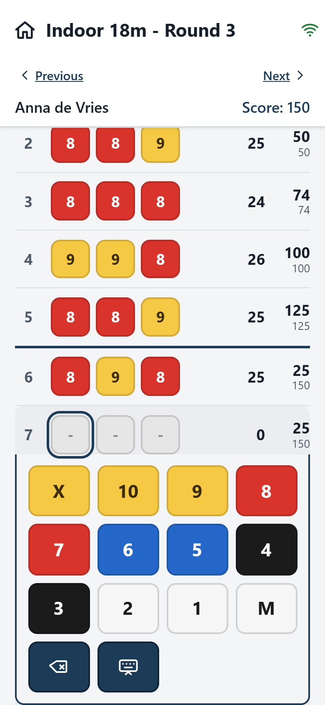
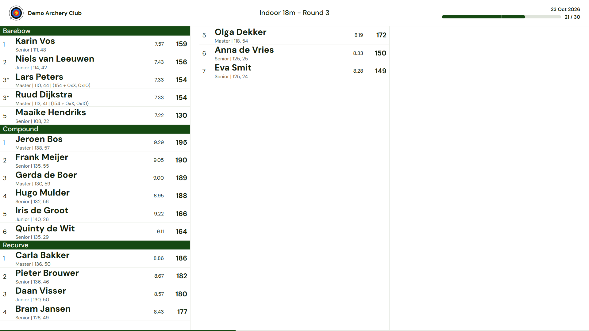
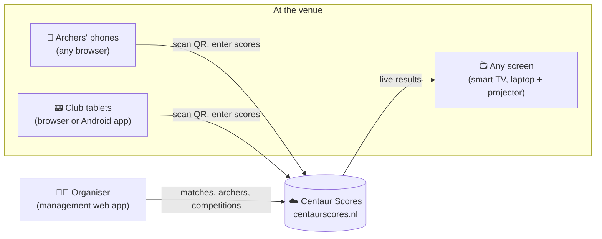
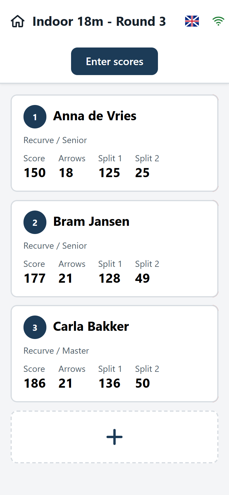
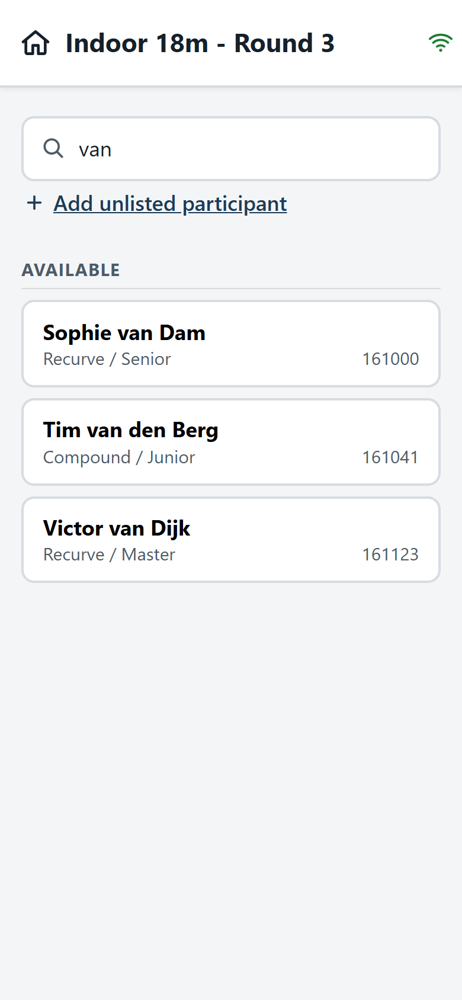
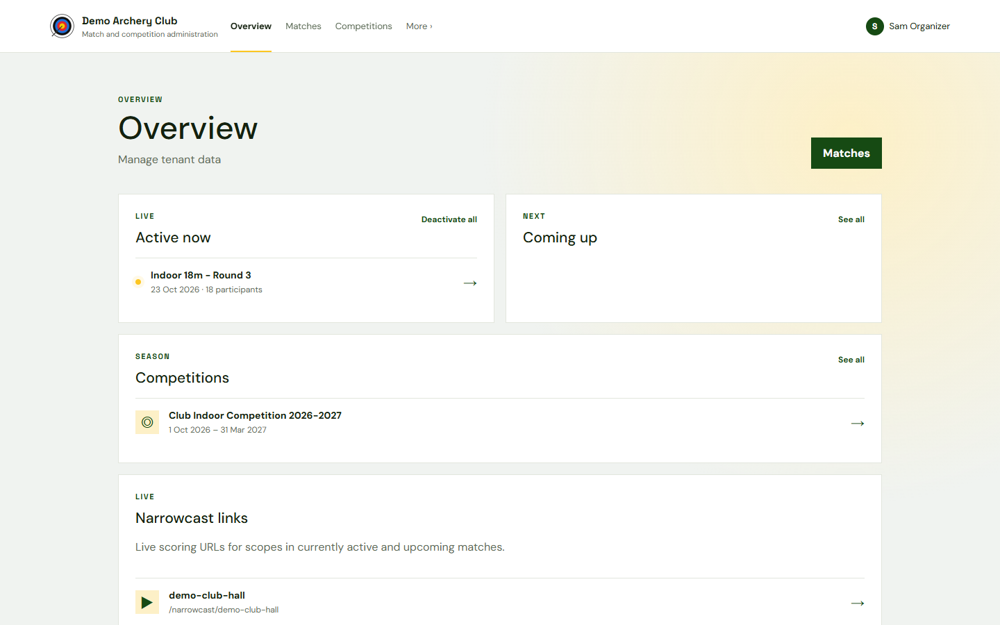
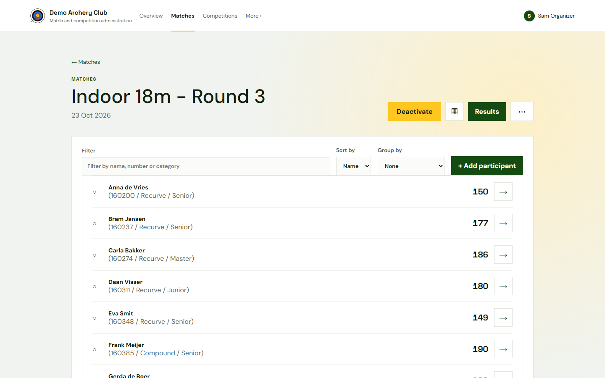
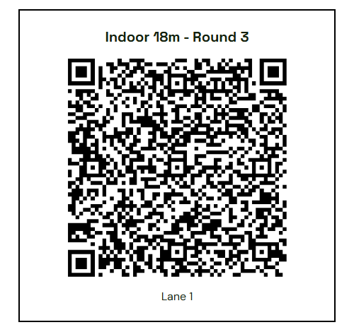
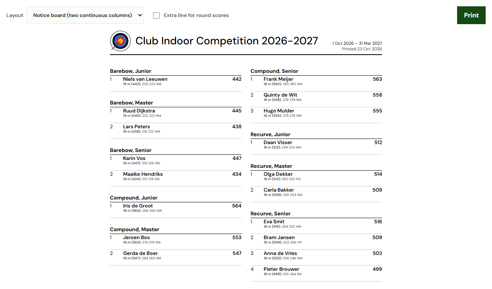

# Centaur Scores

> 🇳🇱 **[Nederlandse versie van deze pagina → README.nl.md](README.nl.md)**

**Live scoring for archery matches. Archers enter their own scores on their phones, and the results appear on any screen in the hall, live.**

No app to install, no accounts for archers and no special hardware. If your archers have a phone with a web browser, you can start scoring today.

  
  &nbsp;&nbsp;
  

---

## Get started in three steps

Centaur Scores is cloud-hosted at **[centaurscores.nl](https://centaurscores.nl)**. If you just want to use it, you don't have to install anything.

1. **Ask for access.** Go to [centaurscores.nl](https://centaurscores.nl) and send an e-mail to ask for an account for your club or organisation.
2. **Create your first match.** Sign in, give the match a name and a date, and choose the number of ends and arrows per end.
3. **Shoot.** Print the QR codes (one per target or lane), or simply let archers register themselves when they arrive. Point a screen at the live-results address and you're running.

Would you rather run it on your own server? See **[Self-hosting Centaur Scores](documentation/SELF-HOSTING.md)**.

---

## How it fits together

You can start with nothing but your archers' phones, and add screens and tablets later as you need them.

**1. The basics: archers' own phones.**
Each target (or lane) gets a QR code. An archer scans it with their phone's camera, and the score card opens in the browser. Nothing to install and no login. The archers on that target enter their arrows on a large, colour-coded keyboard. Scores are kept on the phone and sent to the server in the background, so a flaky Wi-Fi connection does not lose anything.

**2. Add a live display: any screen with a browser.**
Open the live-results address on a smart TV, a laptop with a projector, or a Raspberry Pi behind a monitor. The address is fixed, for example `https://centaurscores.nl/narrowcast/<your-scope>`: set it up once and leave it. The address never changes. What it shows depends on which matches are active: when you open a match, it appears on the screen automatically, and when you close it, it disappears. Results are grouped by category (for example bow type), ranked, and refreshed continuously. The layout scales to fit up to 48 archers on one screen.

**3. Add tablets: for clubs that want dedicated devices.**
If not every archer has a smartphone, or you prefer club-owned devices on the targets, tablets work in two ways:

- **In the browser.** Scan the QR code and use the same web score card as a phone.
- **With the Android app.** Install the [Centaur Scores Android app](https://github.com/pbijdens/centaur-scores-v2/releases/latest) (`app-release.apk`; use `app-debug.apk` on older Android 6 devices). Pair it with a target by scanning its QR code. It stores everything locally and syncs when a connection is available.

---

## Features

### Entering scores: the main goal

- **No installation, no accounts for archers.** Scan the QR code on the target and start scoring in any mobile browser.
- **Built for use at the line.** Large tiles and buttons that are easy to read, Dutch and English, and portrait or landscape. Swipe between archers on the same target.
- **Robust on bad networks.** Every arrow is stored on the device first and synchronised in the background. A status icon shows whether everything has been sent.
- **Configurable keyboard.** X/10/9…/M with target colours, and per category you can disable keys (for example no 1–5 for compound on a 3-spot).
- **Scorecard signing (optional).** No signature, a simple confirmation, or two drawn signatures (archer and marker) on the screen. Once a card is signed, its scores are locked.
- **Android app** for club tablets, as an alternative to the browser.

### Live results

- **One fixed address per display** ("scope"). Screens automatically show the active matches for that scope and cycle between them.
- **Grouped and ranked** by any categories (bow type, class, …), with optional per-arrow average, split totals (for example per 30 arrows), tie-breakers (number of Xs, 10s, …) and personal-best indicators.
- **Designed for big screens.** Deterministic layout that always fits 48 archers on one screen and scrolls horizontally for larger fields.

### Setting up a match: as much or as little preparation as you like

- **Zero preparation.** Create the match, print the QR codes, and let archers **register themselves** at the start by picking their name from the club list on the score card, or adding themselves as a guest.
- **Full preparation.** Import archers from Excel, **assign lanes and targets** in advance (for example `3A`, `3B`), print a lane check-in sheet, and print the QR codes per target.
- **Match templates** let you reuse a configuration (ends, arrows, keyboard, tie-break rules, live-display settings) for every club night.
- Print score cards, export results to CSV, and correct scores from the management app.

### Individual matches and federation competitions

- Run one-off matches, such as rounds of a national or regional competition, without setting up a season.
- **Results can be fetched automatically** by external systems such as the federation's results website (mijn.handboogsport.nl) through an API: see the [integration guide](documentation/INTEGRATION-FIND-MATCHES.en.md).

### Club competitions

- Run a **full competition** over a season: several rounds, one or more matches per round, results grouped by category.
- **Two scoring methods:**
  - **Best scores:** add up each archer's highest *N* scores over the rounds, with an optional minimum number of rounds shot.
  - **Points per round:** rank archers in every round and award F1-style points (12, 10, 8, 7, …), then add up the points.
- Several scoring rules per competition (for example 18 m and 25 m), with a total.
- Printable result lists: a compact two-column layout for the notice board, or a page-by-page version for PDF.

### Personal bests

- Track each archer's **personal best** per discipline and match type.
- Import the current personal bests from an external source (Excel). New records are registered automatically when a match is closed, and can be exported again.
- The live display can highlight archers who are on track to beat their personal best.

### Organisations, accounts and access

- **Tenants (organisations) are fully separated.** A federation, region or club each has its own archers, matches and competitions, and an organisation can have sub-organisations.
- **Accounts with access levels:** *Administrator* (everything, including accounts and sub-organisations), *Manager* (matches, competitions and archer lists) and *Viewer* (read-only).
- Backup and restore per organisation.
- A **WordPress plugin** to embed live match and competition results on your club website.

---

## Screenshots

**Archers (phone, in the browser):**

| Choose your archer | Enter scores | Register yourself |
|:---:|:---:|:---:|
|  |  |  |

**Live display (TV screen):**

**Organiser (management web app):**

| Overview | Match |
|:---:|:---:|
|  |  |
| **QR code per target** | **Competition results** |
|  |  |

---

## Self-hosting

Centaur Scores is open source and can run on your own server: with **Docker Compose**, with the **maintenance scripts for a plain Debian server** (including blue/green updates), or **installed manually**. See:

- 📘 **[Self-hosting Centaur Scores](documentation/SELF-HOSTING.md)**

---

## For developers

This repository is a monorepo with all components:

| Folder | Component | Technology |
|---|---|---|
| [`centaur-scores-api-v2`](centaur-scores-api-v2) | REST API and database | .NET 10, EF Core, MySQL/MariaDB |
| [`centaur-scores-web-ui`](centaur-scores-web-ui) | Management web app and live display (`/narrowcast/...`) | Svelte, TypeScript |
| [`centaur-scores-mobile-web-scoring`](centaur-scores-mobile-web-scoring) | Score card for phones and tablets (served at `/scores/`) | Svelte, TypeScript |
| [`centaur-scores`](centaur-scores) | Android app for score keeping | Flutter |
| [`centaur-scores-wordpress`](centaur-scores-wordpress) | WordPress plugin for embedding results | PHP |
| [`centaur-scores-docker-v2`](centaur-scores-docker-v2) | Docker Compose setup | Docker, nginx |
| [`centaur-scores-setup-and-maintenance`](centaur-scores-setup-and-maintenance) | Install and blue/green update scripts for Debian | Bash |
| [`documentation`](documentation) | Design and feature documentation ([index](documentation/INDEX.md)) | Markdown |
| [`scripts`](scripts) | Debug and data scripts | Bash, Python |

Running locally: start the API with `centaur-scores-api-v2/run-dev.sh` (listens on `http://localhost:5080`, Swagger at `/swagger`). Start each Svelte app with `npm install && npm run dev`. The repository also contains VS Code launch configurations for all three. The full API reference is in [API_ENDPOINTS.md](centaur-scores-api-v2/API_ENDPOINTS.md).

Repository conventions:

- All documentation and generated Markdown goes into [`documentation`](documentation). [INDEX.md](documentation/INDEX.md) in that folder is the index to all documentation.
- All debug scripts go into [`scripts`](scripts).
