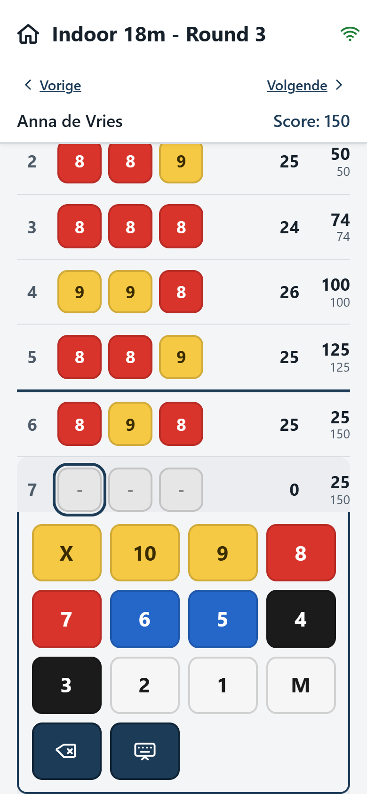
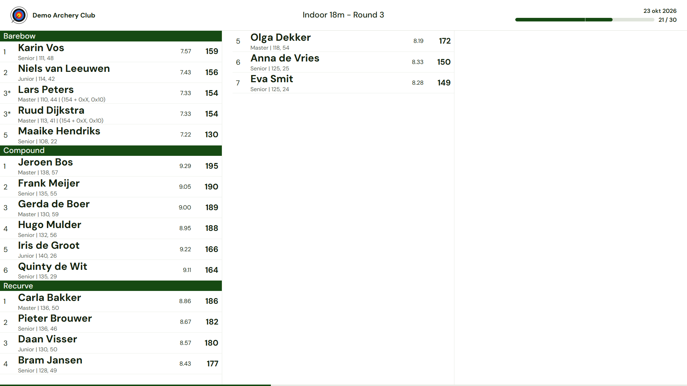
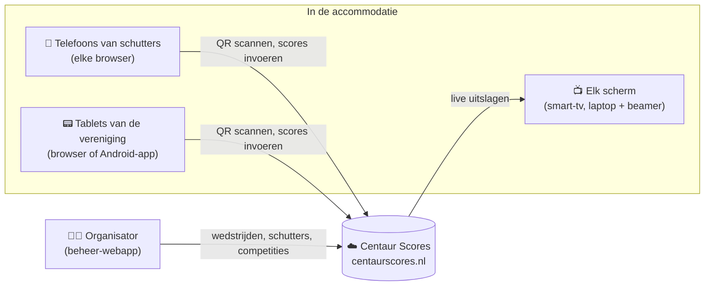
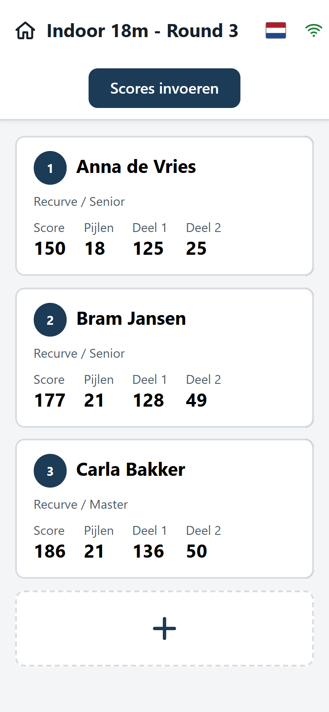
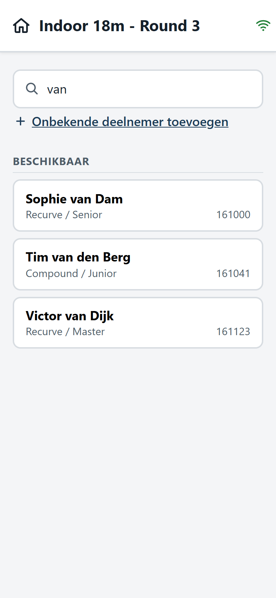
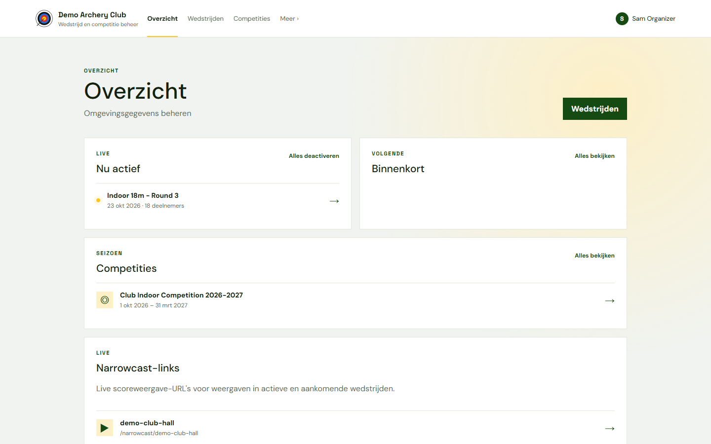
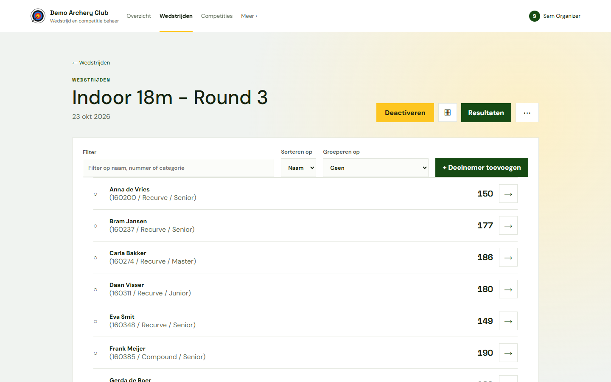
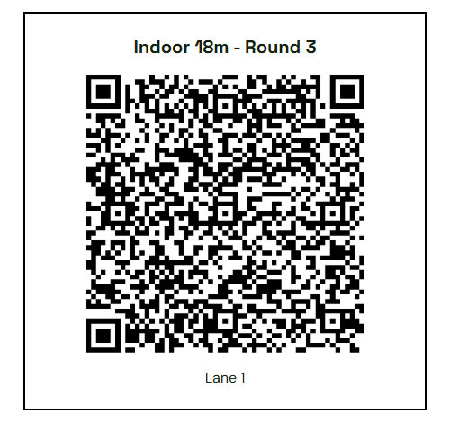
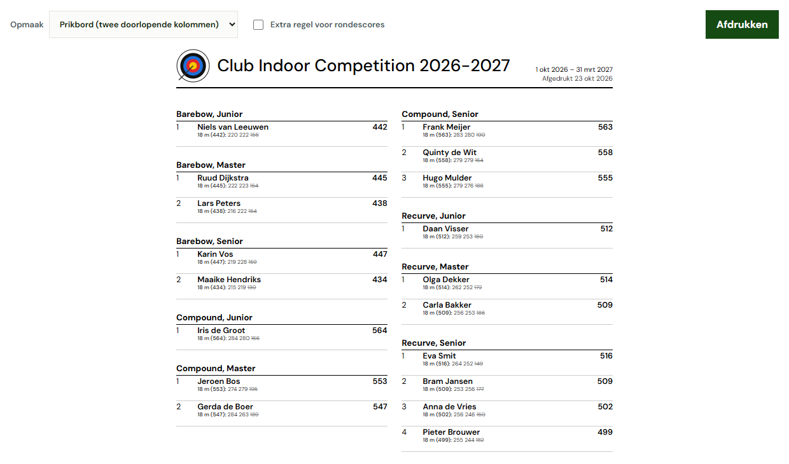

# Centaur Scores

> 🇬🇧 **[English version of this page → README.md](README.md)**

**Live scores voor handboogwedstrijden. Schutters voeren hun eigen scores in op hun telefoon, en de uitslag staat direct op elk scherm in de zaal.**

Er is geen app nodig, schutters hebben geen account nodig en je hebt geen speciale apparatuur nodig. Hebben je schutters een telefoon met een webbrowser? Dan kun je vandaag beginnen.

  
  &nbsp;&nbsp;
  

---

## In drie stappen aan de slag

Centaur Scores draait in de cloud op **[centaurscores.nl](https://centaurscores.nl)**. Wil je het alleen gebruiken? Dan hoef je niets te installeren.

1. **Vraag toegang aan.** Ga naar [centaurscores.nl](https://centaurscores.nl) en stuur een e-mail om een account voor je vereniging of organisatie aan te vragen.
2. **Maak je eerste wedstrijd aan.** Log in, geef de wedstrijd een naam en datum en kies het aantal series en pijlen per serie.
3. **Schieten maar.** Print de QR-codes (één per baan of blazoen), of laat schutters zich bij binnenkomst zelf aanmelden. Zet een scherm op het adres van de live uitslagen en je bent klaar.

Liever op je eigen server? Zie **[Centaur Scores zelf hosten](documentation/SELF-HOSTING.nl.md)**.

---

## Hoe het in elkaar zit

Je kunt beginnen met alleen de telefoons van je schutters en later schermen en tablets toevoegen wanneer je die nodig hebt.

**1. De basis: de eigen telefoons van schutters.**
Elke baan krijgt een QR-code. Een schutter scant die met de camera van de telefoon en de scorekaart opent in de browser. Er hoeft niets geïnstalleerd te worden en er is geen inlog nodig. De schutters op die baan voeren hun pijlen in op een groot toetsenbord in de kleuren van het blazoen. Scores worden op de telefoon bewaard en op de achtergrond naar de server gestuurd, dus bij haperende wifi gaat er niets verloren.

**2. Voeg een live-scherm toe: elk scherm met een browser.**
Open het adres voor live uitslagen op een smart-tv, een laptop met beamer of een Raspberry Pi achter een monitor. Het adres is vast, bijvoorbeeld `https://centaurscores.nl/narrowcast/<jouw-scope>`: één keer instellen en laten staan. Het adres verandert nooit. Wat er te zien is, hangt af van welke wedstrijden actief zijn: zet je een wedstrijd open, dan verschijnt die automatisch op het scherm, en sluit je hem, dan verdwijnt hij weer. Uitslagen worden gegroepeerd per categorie (bijvoorbeeld boogtype), gerangschikt en steeds ververst. De weergave schaalt zo dat tot 48 schutters op één scherm passen.

**3. Voeg tablets toe: voor verenigingen die vaste apparaten willen.**
Heeft niet iedere schutter een smartphone, of wil je liever verenigingsapparaten bij de banen? Tablets kun je op twee manieren gebruiken:

- **In de browser.** Scan de QR-code en gebruik dezelfde web-scorekaart als op een telefoon.
- **Met de Android-app.** Installeer de [Centaur Scores Android-app](https://github.com/pbijdens/centaur-scores-v2/releases/latest) (`app-release.apk`; gebruik `app-debug.apk` op oudere Android 6-apparaten). Koppel de app aan een baan door de QR-code te scannen. De app bewaart alles lokaal en synchroniseert zodra er verbinding is.

---

## Mogelijkheden

### Scores invoeren: daar draait het om

- **Geen installatie, geen accounts voor schutters.** Scan de QR-code bij de baan en begin met scoren in elke mobiele browser.
- **Gemaakt voor gebruik op de schietlijn.** Grote, goed leesbare tegels en knoppen, Nederlands en Engels, staand of liggend. Swipe tussen de schutters op dezelfde baan.
- **Bestand tegen slechte verbindingen.** Elke pijl wordt eerst op het apparaat opgeslagen en op de achtergrond gesynchroniseerd. Een statusicoon laat zien of alles is verstuurd.
- **Instelbaar toetsenbord.** X/10/9…/M in de blazoenkleuren, en per categorie kun je toetsen uitschakelen (bijvoorbeeld geen 1–5 voor compound op een drieblazoen).
- **Scorekaart ondertekenen (optioneel).** Geen handtekening, een eenvoudige bevestiging, of twee getekende handtekeningen (schutter en schrijver) op het scherm. Na ondertekenen liggen de scores vast.
- **Android-app** voor tablets van de vereniging, als alternatief voor de browser.

### Live uitslagen

- **Eén vast adres per scherm** ("scope"). Schermen tonen automatisch de actieve wedstrijden voor die scope en wisselen daartussen.
- **Gegroepeerd en gerangschikt** op elke categorie (boogtype, klasse, …), met optioneel het gemiddelde per pijl, tussenstanden (bijvoorbeeld per 30 pijlen), beslissers bij gelijke stand (aantal X'en, 10'en, …) en PR-indicatoren.
- **Ontworpen voor grote schermen.** Een vaste opmaak waarin altijd 48 schutters op één scherm passen, en die bij grotere velden horizontaal doorschuift.

### Een wedstrijd opzetten: zoveel of zo weinig voorbereiding als je wilt

- **Geen voorbereiding.** Maak de wedstrijd aan, print de QR-codes en laat schutters **zichzelf aanmelden** bij de start: ze kiezen hun naam uit de ledenlijst op de scorekaart, of voegen zichzelf toe als gast.
- **Volledige voorbereiding.** Importeer schutters uit Excel, maak vooraf een **baanindeling** (bijvoorbeeld `3A`, `3B`), print een aanmeldlijst per baan en print de QR-codes per baan.
- **Wedstrijdsjablonen** om een instelling (series, pijlen, toetsenbord, beslisregels, live-weergave) voor elke clubavond te hergebruiken.
- Scorekaarten printen, uitslagen exporteren naar CSV en scores corrigeren vanuit de beheer-app.

### Losse wedstrijden en bondscompetities

- Organiseer losse wedstrijden, zoals rondes van een landelijke of regionale competitie, zonder een heel seizoen in te richten.
- **Uitslagen kunnen automatisch worden opgehaald** door externe systemen zoals mijn.handboogsport.nl via een API: zie de [integratiehandleiding](documentation/INTEGRATION-FIND-MATCHES.nl.md).

### Verenigingscompetities

- Houd een **volledige competitie** bij over een seizoen: meerdere rondes, één of meer wedstrijden per ronde, uitslagen per categorie.
- **Twee manieren van puntentelling:**
  - **Beste scores:** tel per schutter de hoogste *N* scores over de rondes op, met optioneel een minimum aantal geschoten rondes.
  - **Punten per ronde:** rangschik de schutters in elke ronde, ken punten toe zoals in de Formule 1 (12, 10, 8, 7, …) en tel die op.
- Meerdere telregels per competitie (bijvoorbeeld 18 m en 25 m), met een totaal.
- Printbare uitslagenlijsten: compact in twee kolommen per pagina, op elk gangbaar papierformaat.

### Persoonlijke records

- Houd per schutter het **persoonlijk record (PR)** bij per discipline en wedstrijdsoort.
- Importeer de bestaande PR's uit een externe bron (Excel). Nieuwe records worden automatisch geregistreerd bij het sluiten van een wedstrijd en kunnen weer worden geëxporteerd.
- Het live-scherm kan schutters markeren die op koers liggen voor een nieuw PR.

### Organisaties, accounts en rechten

- **Organisaties (omgevingen) zijn volledig van elkaar gescheiden.** Een bond, regio of vereniging heeft elk eigen schutters, wedstrijden en competities, en een omgeving kan deelomgevingen hebben.
- **Accounts met verschillende rechten:** *Beheerder* (alles, inclusief accounts en deelomgevingen), *Manager* (wedstrijden, competities en schutterslijsten) en *Kijker* (alleen lezen).
- Back-up en herstel per organisatie.
- Een **WordPress-plugin** om live wedstrijd- en competitie-uitslagen op de website van je vereniging te tonen.

---

## Schermafbeeldingen

**Schutters (telefoon, in de browser):**

| Kies je schutter | Scores invoeren | Zelf aanmelden |
|:---:|:---:|:---:|
|  |  |  |

**Live-scherm (tv):**

**Organisator (beheer-webapp):**

| Overzicht | Wedstrijd |
|:---:|:---:|
|  |  |
| **QR-code per baan** | **Competitie-uitslag** |
|  |  |

---

## Zelf hosten

Centaur Scores is open source en kan op je eigen server draaien: met **Docker Compose**, met de **beheerscripts voor een kale Debian-server** (inclusief blue/green-updates), of **handmatig geïnstalleerd**. Zie:

- 📘 **[Centaur Scores zelf hosten](documentation/SELF-HOSTING.nl.md)**

---

## Voor ontwikkelaars

Deze repository is een monorepo met alle onderdelen:

| Map | Onderdeel | Techniek |
|---|---|---|
| [`centaur-scores-api-v2`](centaur-scores-api-v2) | REST-API en database | .NET 10, EF Core, MySQL/MariaDB |
| [`centaur-scores-web-ui`](centaur-scores-web-ui) | Beheer-webapp en live-scherm (`/narrowcast/...`) | Svelte, TypeScript |
| [`centaur-scores-mobile-web-scoring`](centaur-scores-mobile-web-scoring) | Scorekaart voor telefoons en tablets (op `/scores/`) | Svelte, TypeScript |
| [`centaur-scores`](centaur-scores) | Android-app voor het bijhouden van scores | Flutter |
| [`centaur-scores-wordpress`](centaur-scores-wordpress) | WordPress-plugin voor het tonen van uitslagen | PHP |
| [`centaur-scores-docker-v2`](centaur-scores-docker-v2) | Docker Compose-opzet | Docker, nginx |
| [`centaur-scores-setup-and-maintenance`](centaur-scores-setup-and-maintenance) | Installatie- en blue/green-updatescripts voor Debian | Bash |
| [`documentation`](documentation) | Ontwerp- en functiedocumentatie ([index](documentation/INDEX.md)) | Markdown |
| [`scripts`](scripts) | Debug- en datascripts | Bash, Python |

Lokaal draaien: start de API met `centaur-scores-api-v2/run-dev.sh` (luistert op `http://localhost:5080`, Swagger op `/swagger`). Start elke Svelte-app met `npm install && npm run dev`. De repository bevat ook VS Code-startconfiguraties voor alle drie. De volledige API-referentie staat in [API_ENDPOINTS.md](centaur-scores-api-v2/API_ENDPOINTS.md).
