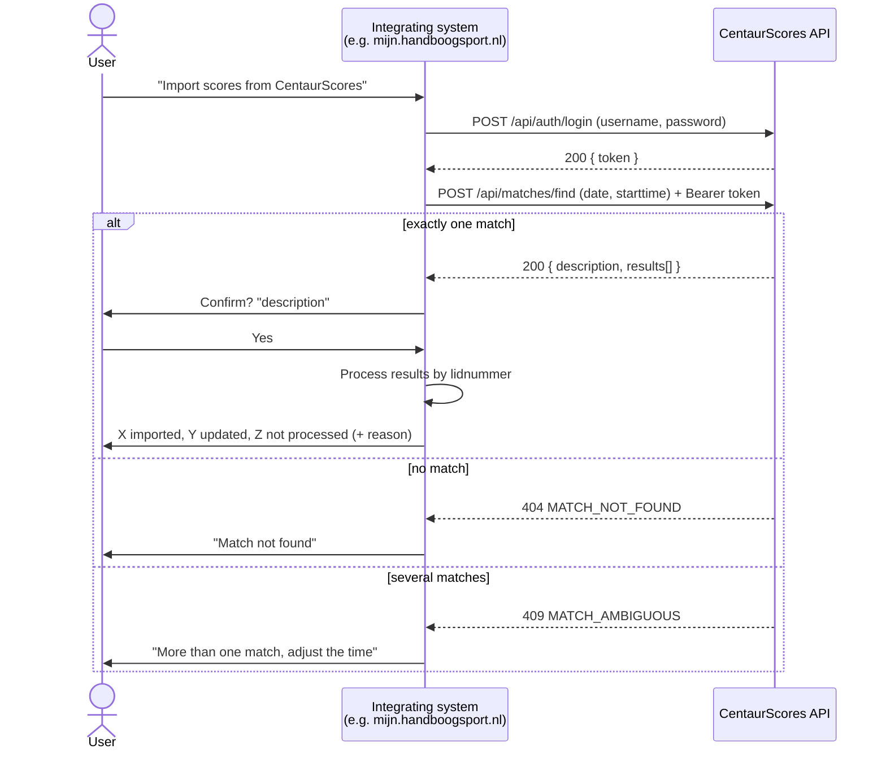
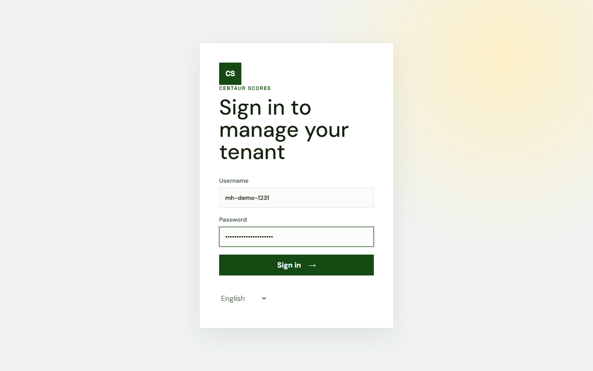
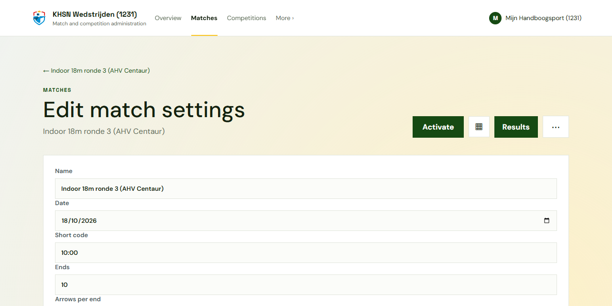
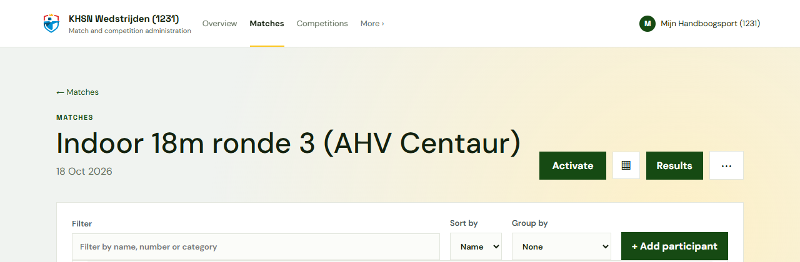
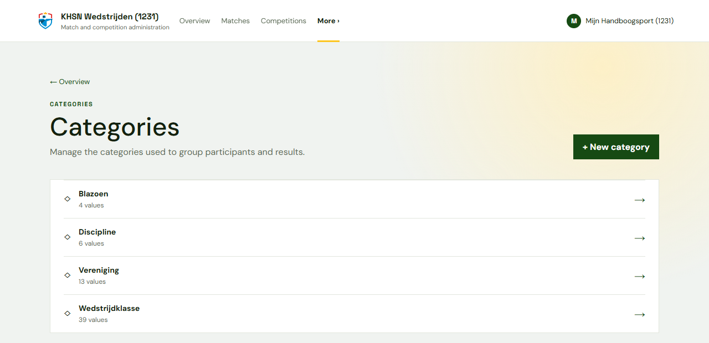
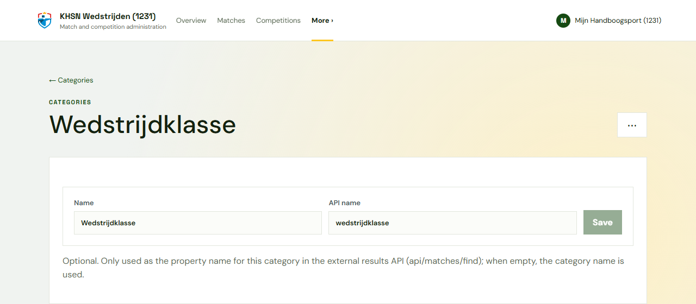

# Integration guide: importing scores from CentaurScores

This guide is for developers and administrators of a system that imports match results from CentaurScores, for example **mijn.handboogsport.nl**. It covers the whole chain: preparing the match in CentaurScores, configuring the integration, and fetching and processing the scores. The API steps include `curl` examples.

## Contents

- [Integration guide: importing scores from CentaurScores](#integration-guide-importing-scores-from-centaurscores)
  - [Contents](#contents)
  - [1. How it works](#1-how-it-works)
  - [2. Preparing the match in CentaurScores](#2-preparing-the-match-in-centaurscores)
    - [2.1 Account for the integration](#21-account-for-the-integration)
    - [2.2 Match date and start time](#22-match-date-and-start-time)
    - [2.3 Category API names (optional)](#23-category-api-names-optional)
  - [3. Configuring the integrating system](#3-configuring-the-integrating-system)
  - [4. User flow](#4-user-flow)
  - [5. API calls with curl](#5-api-calls-with-curl)
    - [5.1 Signing in](#51-signing-in)
    - [5.2 Finding the match and fetching its results](#52-finding-the-match-and-fetching-its-results)
  - [6. Processing the results](#6-processing-the-results)
  - [7. Error handling](#7-error-handling)
  - [8. Testing against a local environment](#8-testing-against-a-local-environment)

---

## 1. How it works

The integrating system signs in to CentaurScores with a dedicated account and then looks up one match by **date** and **start time**. CentaurScores returns the results of that match: per participant the name, federation number (`lidnummer`), total score and categories (such as bow type and competition class).



Key points:

- The endpoint **never returns more than one match**: no hit gives `404`, more than one hit gives `409`.
- Both **closed** and still **active** matches are found. Preferably import only after the match has finished.
- The account only needs read access (authorization profile *Viewer*). It does not have to select an environment (tenant): the search covers every environment the account has access to.

## 2. Preparing the match in CentaurScores

The match organisers do these steps in the CentaurScores admin interface.

### 2.1 Account for the integration

Ask the CentaurScores administrator for a separate account for the integration, for example `mh-demo-1231` for club 1231. The *Viewer* profile is enough. Use this account for the integration only, so its password can be changed independently of personal accounts.

The account sees the matches of its own environment and of all environments below it.



### 2.2 Match date and start time

The match is found by **date** and **short code**. Under *Matches → (match) → Edit settings*, enter the match's start time in the **Short code** field, in 24-hour notation (`hh:mm`, for example `10:00`).



Note:

- `9:30` and `09:30` are treated as the same time. A short code that is not a time (for example `OPEN`) is never found.
- The combination of date and start time must be **unique** across all environments the integration account can access. If two matches share the same date and start time, the endpoint returns `409` and the short code of one of them must be changed.

The match date and status are also shown on the match page:



### 2.3 Category API names (optional)

Each category of a participant (such as discipline or competition class) appears as an extra property in the results. By default the property name is the category's name. Under *More → Categories* you can set a fixed **API name** per category. The integrating system can then rely on stable names, even if the display name changes later.





API name rules:

- At most 64 characters and unique within the environment (case-insensitive).
- `name`, `score` and `lidnummer` are reserved and cannot be used.
- If the field is left empty, the category name is used.

Agree on the API names with the administrator of the integrating system. In the example environment they are `blazoen`, `boogtype`, `vereniging` and `wedstrijdklasse`.

## 3. Configuring the integrating system

Add these three settings to the integrating system's configuration:

| Setting | Example value | Notes |
|---|---|---|
| **CentaurScores API base URL** | `https://scores.ahv-centaur.nl/api` | The base URL under which the API is published. |
| **Username** | `mh-demo-1231` | The integration account from step 2.1. |
| **Password** | *(secret)* | Store it encrypted, like the system's other secrets. Never write it to logs. |

> **Mind the double `/api`.** The API paths themselves already start with `/api/`. With the base URL `https://scores.ahv-centaur.nl/api`, the full addresses are:
>
> - `https://scores.ahv-centaur.nl/api/api/auth/login`
> - `https://scores.ahv-centaur.nl/api/api/matches/find`
>
> Append the paths to the base URL without adding or dropping a `/`. That keeps the integration working if the API moves to another address later.

## 4. User flow

1. **Configure** (once): the administrator fills in the three settings from section 3.
2. **Match finished:** after the match, the user signs in to the integrating system (for example mijn.handboogsport.nl).
3. The user opens the match there and chooses the function **"Scores importeren uit CentaurScores"** (*Import scores from CentaurScores*).
4. The system sends a `POST` to `…/api/auth/login` with the configured username and password.
5. The system takes the `token` from the reply and uses it for a `POST` to `…/api/matches/find`, with the match date and start time as known in the integrating system.
6. **For any status code other than 200**, the system shows an error, for example:
   - `409` → *"More than one match was found on this date and time. Adjust the time."* (Dutch: *"meer dan één wedstrijd, pas de tijd aan"*)
   - `404` → *"The match cannot be found in CentaurScores."* (Dutch: *"kan de wedstrijd niet vinden"*)
   - see [section 7](#7-error-handling) for all messages.
7. **On 200**, the system asks for confirmation and shows the `description` from the reply, for example:
   > *Import scores of "KHSN Wedstrijden (1231) - Indoor 18m ronde 3 (AHV Centaur)"? (26 participants)*
8. After confirmation, the system processes the results **by `lidnummer`** and updates the match results (see [section 6](#6-processing-the-results)).
9. Finally, the system shows how many records were **imported** or **updated**, and lists the records that **could not be processed**, with the reason. For example:
   > *24 results processed: 20 imported, 4 updated.*
   > *2 results not processed:*
   > *- Bob Bowman: no federation number known in CentaurScores*
   > *- Carla Pijl (999999): federation number not found*

## 5. API calls with curl

The examples keep the base URL in a variable and use `jq` to read the token from the reply.

```bash
BASE="https://scores.ahv-centaur.nl/api"
```

### 5.1 Signing in

```bash
curl -s -X POST "$BASE/api/auth/login" \
  -H "Content-Type: application/json" \
  -d '{"username":"mh-demo-1231","password":"<password>"}'
```

Reply (`200 OK`, shortened):

```json
{
  "token": "eyJhbGciOiJIUzI1NiIsInR5cCI6IkpXVCJ9...",
  "expiresAt": "2026-10-22T12:49:20Z",
  "account": { "id": "3972e663-…", "username": "mh-demo-1231", "displayName": "Mijn Handboogsport (1231)", "email": "" }
}
```

A wrong username or password gives `401 Unauthorized` with `{"code":"INVALID_CREDENTIALS", …}`.

The token is valid for a few hours (`expiresAt`). Just sign in again for each import; there is no need to keep tokens. The token does not have to be bound to an environment: the `select-tenant` call that the admin interface uses is **not** needed for this integration.

Storing the token in a variable:

```bash
TOKEN=$(curl -s -X POST "$BASE/api/auth/login" \
  -H "Content-Type: application/json" \
  -d '{"username":"mh-demo-1231","password":"<password>"}' | jq -r .token)
```

### 5.2 Finding the match and fetching its results

```bash
curl -s -X POST "$BASE/api/matches/find" \
  -H "Authorization: Bearer $TOKEN" \
  -H "Content-Type: application/json" \
  -d '{"date":"2026-10-18","starttime":"10:00"}'
```

Request body:

| Property | Format | Example |
|---|---|---|
| `date` | `YYYY-MM-DD` | `"2026-10-18"` |
| `starttime` | `hh:mm` (24-hour) | `"10:00"` |

Other properties (for example `verenigingsnummer`, `afstand` or `aantal pijlen`) may be sent and do not cause an error, but they are not used.

Reply (`200 OK`; names and federation numbers are fictional):

```json
{
  "description": "KHSN Wedstrijden (1231) - Indoor 18m ronde 3 (AHV Centaur)",
  "date": "2026-10-18",
  "shortCode": "10:00",
  "results": [
    {
      "name": "Amy Archer",
      "score": 276,
      "lidnummer": "100001",
      "blazoen": "DT",
      "boogtype": "Compound",
      "vereniging": "[1231] AHV Centaur",
      "wedstrijdklasse": "Compound klasse 1"
    },
    {
      "name": "Bob Bowman",
      "score": 254,
      "lidnummer": null,
      "blazoen": "40cm",
      "boogtype": "Recurve",
      "wedstrijdklasse": "Recurve klasse onbekend"
    }
  ]
}
```

| Property | Meaning |
|---|---|
| `description` | Environment name + `" - "` + match name. Show this in the confirmation question. |
| `date`, `shortCode` | Date and short code (start time) as stored in CentaurScores. |
| `results` | One row per participant, ordered by score (highest first), then by name. |
| `results[].name` | The participant's full name. |
| `results[].score` | The participant's total score in this match; `0` if no arrows were entered. |
| `results[].lidnummer` | Federation number (string), or `null` if unknown. |
| *other properties* | One per category for which the participant has a value. The name is the API name (or the category name); the value is the name of the category value. If there is no value, the property is left out. |

## 6. Processing the results

Recommended processing in the integrating system:

1. **Match on `lidnummer`.** Look up the archer for each row by federation number.
2. **Existing result** for this archer in this match → update it (counts as *updated*).
3. **No result yet** → add it (counts as *imported*).
4. **Do not process** the row, with these reasons:

   | Situation | Suggested reason |
   |---|---|
   | `lidnummer` is `null` or empty | No federation number known in CentaurScores |
   | `lidnummer` does not exist in the integrating system | Federation number not found |
   | The same `lidnummer` appears more than once in `results` | Federation number appears more than once in the results |
   | Score or category does not fit the match (e.g. unknown discipline) | Invalid data: … |

5. Preferably process the import **in a single transaction**, so a failure halfway does not leave half a result list behind.
6. Make the import **repeatable**: importing the same match a second time updates the same rows and does not create duplicate results.
7. Do not assume the category properties are always present. A participant without a value for a category does not have that property.

## 7. Error handling

On an error the API returns a JSON body `{ "code": "…", "message": "…" }`. Base the logic on `code`; `message` is English text meant for logs, not for end users.

| Status | `code` | When | Suggested message for the user |
|---|---|---|---|
| `401` | `INVALID_CREDENTIALS` | Sign-in failed | *"Signing in to CentaurScores failed. Check the username and password in the configuration."* |
| `401` | *(no body)* | Token missing, invalid or expired | *"Signing in to CentaurScores failed. Please try again."* |
| `400` | `INVALID_DATE` | Date missing or not a valid `YYYY-MM-DD` | *"The match date is invalid."* |
| `400` | `INVALID_STARTTIME` | Start time missing or not a valid `hh:mm` | *"The match start time is invalid."* |
| `404` | `MATCH_NOT_FOUND` | No match on this date and time | *"The match cannot be found in CentaurScores. Check the date and start time."* |
| `409` | `MATCH_AMBIGUOUS` | More than one match on this date and time | *"More than one match was found on this date and time. Adjust the time."* |
| `5xx` / timeout | – | CentaurScores unreachable | *"CentaurScores is currently unreachable. Please try again later."* |

Example of a `409`:

```json
{
  "code": "MATCH_AMBIGUOUS",
  "message": "More than one match found on 2026-10-18 at 10:00: KHSN Wedstrijden (1231) - Indoor 18m ronde 3 (AHV Centaur); KHSN Wedstrijden (1231) - Indoor 18m ronde 3 herhaling."
}
```

The `message` names the conflicting matches. That helps the match organisers change the short code of one of them (see [2.2](#22-match-date-and-start-time)).

## 8. Testing against a local environment

A CentaurScores development environment runs on `http://localhost:5080` by default, with the admin interface on `http://localhost:5173`. There the API paths sit directly under the root, so without the extra `/api` from section 3:

```bash
BASE="http://localhost:5080"

TOKEN=$(curl -s -X POST "$BASE/api/auth/login" \
  -H "Content-Type: application/json" \
  -d '{"username":"mh-demo-1231","password":"<password>"}' | jq -r .token)

# Found: 200
curl -s -X POST "$BASE/api/matches/find" -H "Authorization: Bearer $TOKEN" \
  -H "Content-Type: application/json" -d '{"date":"2026-10-18","starttime":"10:00"}' | jq '.description, (.results | length)'
# "KHSN Wedstrijden (1231) - Indoor 18m ronde 3 (AHV Centaur)"
# 26

# Not found: 404
curl -s -o /dev/null -w "%{http_code}\n" -X POST "$BASE/api/matches/find" -H "Authorization: Bearer $TOKEN" \
  -H "Content-Type: application/json" -d '{"date":"2026-10-18","starttime":"11:00"}'
# 404
```

When testing, configure `http://localhost:5080` as the base URL in the integrating system.
