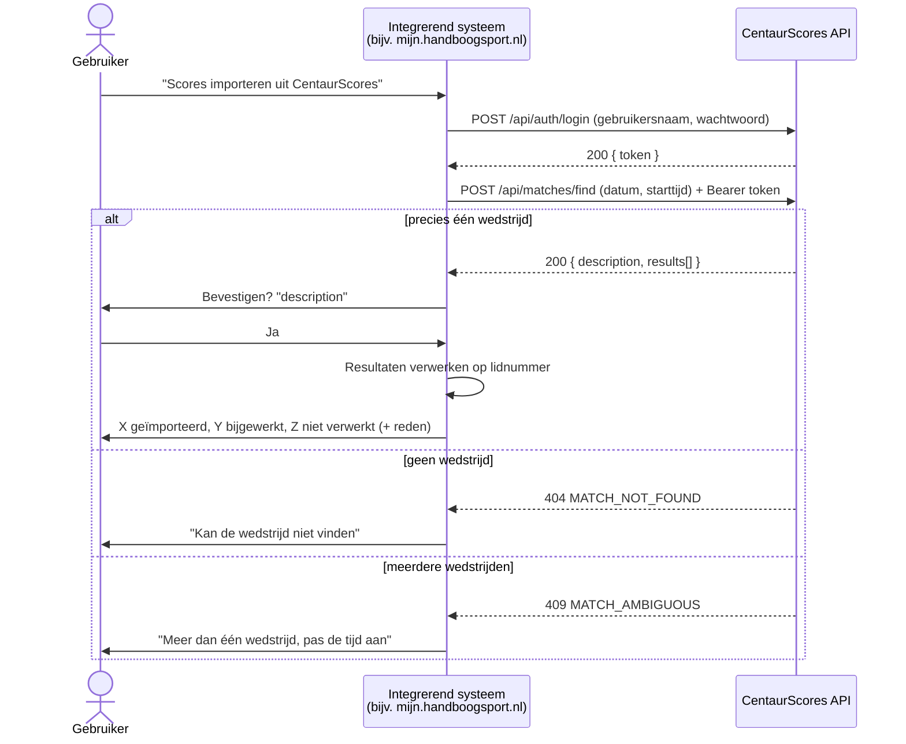
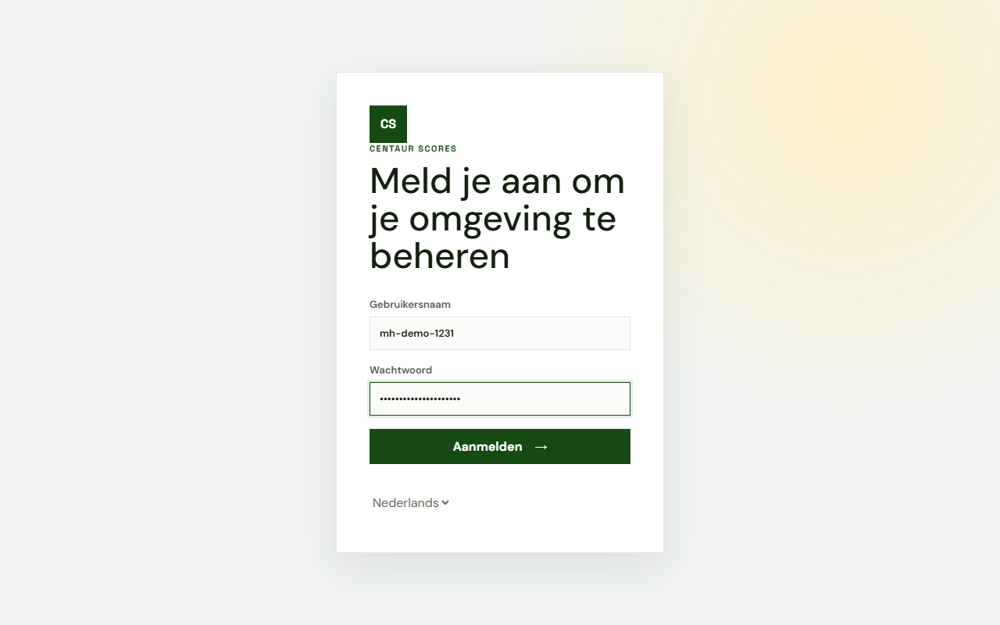
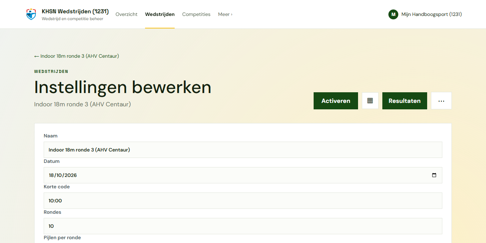
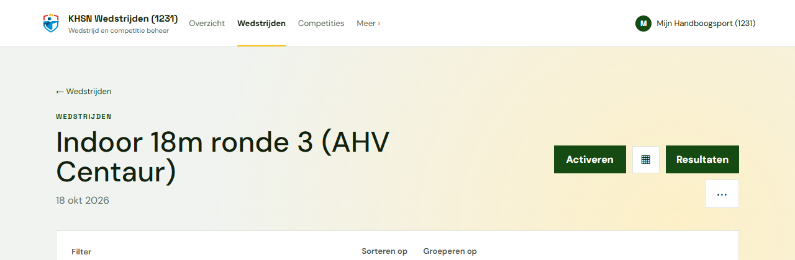
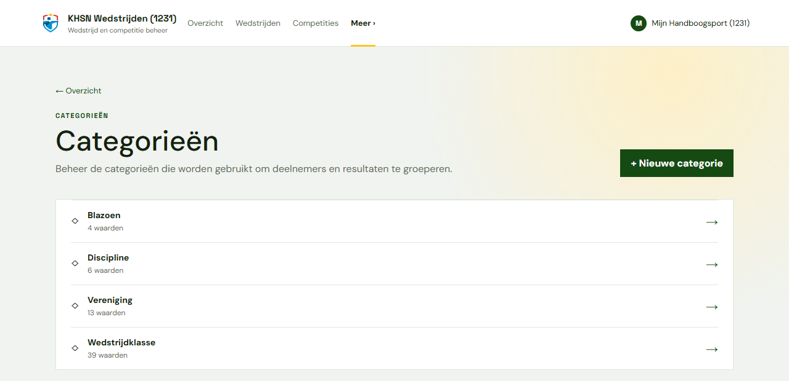
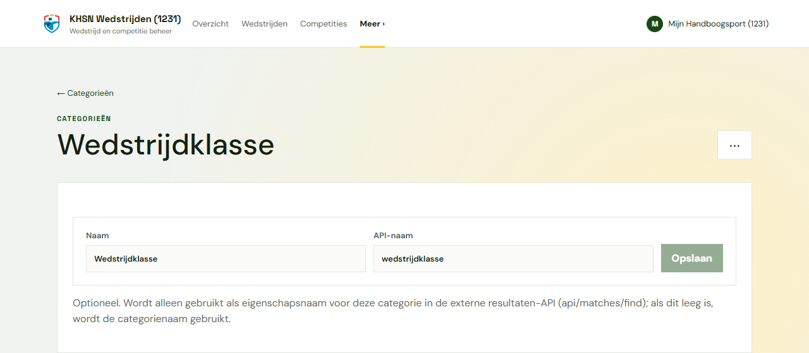

# Integratiehandleiding: scores importeren uit CentaurScores

Deze handleiding is bedoeld voor ontwikkelaars en beheerders van een systeem dat wedstrijduitslagen uit CentaurScores wil overnemen, bijvoorbeeld **mijn.handboogsport.nl**. Hij beschrijft de hele keten: de wedstrijd voorbereiden in CentaurScores, de koppeling configureren, en de scores ophalen en verwerken. Bij de API-stappen staan `curl`-voorbeelden.

## Inhoud

- [Integratiehandleiding: scores importeren uit CentaurScores](#integratiehandleiding-scores-importeren-uit-centaurscores)
  - [Inhoud](#inhoud)
  - [1. Hoe het werkt](#1-hoe-het-werkt)
  - [2. Wedstrijd voorbereiden in CentaurScores](#2-wedstrijd-voorbereiden-in-centaurscores)
    - [2.1 Account voor de koppeling](#21-account-voor-de-koppeling)
    - [2.2 Datum en starttijd van de wedstrijd](#22-datum-en-starttijd-van-de-wedstrijd)
    - [2.3 API-namen van categorieën (optioneel)](#23-api-namen-van-categorieën-optioneel)
  - [3. Koppeling configureren in het integrerende systeem](#3-koppeling-configureren-in-het-integrerende-systeem)
  - [4. Werkwijze voor de gebruiker](#4-werkwijze-voor-de-gebruiker)
  - [5. API-aanroepen met curl](#5-api-aanroepen-met-curl)
    - [5.1 Aanmelden](#51-aanmelden)
    - [5.2 Wedstrijd zoeken en uitslag ophalen](#52-wedstrijd-zoeken-en-uitslag-ophalen)
  - [6. Resultaten verwerken](#6-resultaten-verwerken)
  - [7. Foutafhandeling](#7-foutafhandeling)
  - [8. Testen tegen een lokale omgeving](#8-testen-tegen-een-lokale-omgeving)

---

## 1. Hoe het werkt

Het integrerende systeem meldt zich aan bij CentaurScores met een vast account en zoekt daarna één wedstrijd op aan de hand van **datum** en **starttijd**. CentaurScores stuurt dan de uitslag van die wedstrijd terug: per deelnemer de naam, het lidnummer, de totaalscore en de categorieën (zoals boogtype en wedstrijdklasse).



Belangrijk om te weten:

- Het endpoint geeft **nooit meer dan één wedstrijd** terug. Bij geen treffer volgt `404`, bij meer dan één treffer `409`.
- Zowel **afgesloten** als nog **actieve** wedstrijden worden gevonden. Importeer bij voorkeur pas als de wedstrijd klaar is.
- Het account heeft alleen leesrechten nodig (autorisatieniveau *Viewer*). Het hoeft geen omgeving (tenant) te kiezen: er wordt gezocht in alle omgevingen waar het account toegang toe heeft.

## 2. Wedstrijd voorbereiden in CentaurScores

Deze stappen voert de wedstrijdorganisatie uit in de CentaurScores-beheeromgeving.

### 2.1 Account voor de koppeling

Vraag de beheerder van CentaurScores om een apart account voor de koppeling, bijvoorbeeld `mh-demo-1231` voor vereniging 1231. Het autorisatieniveau *Viewer* is voldoende. Gebruik dit account alleen voor de koppeling, zodat het wachtwoord los van persoonlijke accounts kan worden gewijzigd.

Het account ziet de wedstrijden van zijn eigen omgeving en van alle onderliggende omgevingen.



### 2.2 Datum en starttijd van de wedstrijd

De wedstrijd wordt gevonden op **datum** en **korte code**. Vul bij *Wedstrijden → (wedstrijd) → Instellingen bewerken* in het veld **Korte code** de starttijd van de wedstrijd in, in 24-uursnotatie (`uu:mm`, bijvoorbeeld `10:00`).



Let op:

- `9:30` en `09:30` worden als dezelfde tijd gezien. Een korte code die geen tijd is (bijvoorbeeld `OPEN`) wordt nooit gevonden.
- De combinatie van datum en starttijd moet **uniek** zijn binnen alle omgevingen waar het koppelingsaccount bij kan. Zijn er twee wedstrijden op dezelfde dag met dezelfde starttijd, dan geeft het endpoint `409` en moet de korte code van een van beide worden aangepast.

De datum en status van de wedstrijd zijn ook op de wedstrijdpagina te zien:



### 2.3 API-namen van categorieën (optioneel)

Elke categorie van een deelnemer (zoals discipline of wedstrijdklasse) komt als extra eigenschap in de uitslag. De eigenschapsnaam is standaard de naam van de categorie. Via *Meer → Categorieën* kun je per categorie een vaste **API-naam** instellen. Het integrerende systeem kan dan op stabiele namen rekenen, ook als de weergavenaam later verandert.





Regels voor de API-naam:

- Maximaal 64 tekens en uniek binnen de omgeving (hoofdletters tellen niet mee).
- `name`, `score` en `lidnummer` zijn gereserveerd en kunnen niet worden gebruikt.
- Laat je het veld leeg, dan wordt de categorienaam gebruikt.

Spreek de API-namen af met de beheerder van het integrerende systeem. Bij de voorbeeldomgeving zijn dat `blazoen`, `boogtype`, `vereniging` en `wedstrijdklasse`.

## 3. Koppeling configureren in het integrerende systeem

Neem in de systeemconfiguratie van het integrerende systeem deze drie instellingen op:

| Instelling | Voorbeeldwaarde | Toelichting |
|---|---|---|
| **CentaurScores API-basis-URL** | `https://scores.ahv-centaur.nl/api` | De basis-URL waaronder de API is gepubliceerd. |
| **Gebruikersnaam** | `mh-demo-1231` | Het koppelingsaccount uit stap 2.1. |
| **Wachtwoord** | *(geheim)* | Sla dit versleuteld op, zoals andere geheimen van het systeem. Toon het nooit in logbestanden. |

> **Let op de dubbele `/api`.** De API-paden beginnen zelf al met `/api/`. Met de basis-URL `https://scores.ahv-centaur.nl/api` worden de volledige adressen dus:
>
> - `https://scores.ahv-centaur.nl/api/api/auth/login`
> - `https://scores.ahv-centaur.nl/api/api/matches/find`
>
> Plak de paden zonder extra of ontbrekende `/` aan de basis-URL vast. Zo blijft de koppeling werken als de API later op een ander adres staat.

## 4. Werkwijze voor de gebruiker

1. **Configureren** (eenmalig): de beheerder vult de drie instellingen uit hoofdstuk 3 in.
2. **Wedstrijd afgerond:** na afloop van de wedstrijd meldt de gebruiker zich aan bij het integrerende systeem (bijvoorbeeld mijn.handboogsport.nl).
3. De gebruiker opent daar de wedstrijd en kiest de functie **"Scores importeren uit CentaurScores"**.
4. Het systeem doet een `POST` naar `…/api/auth/login` met de geconfigureerde gebruikersnaam en het wachtwoord.
5. Het systeem haalt het `token` uit het antwoord en doet daarmee een `POST` naar `…/api/matches/find`, met de datum en starttijd van de wedstrijd zoals die in het integrerende systeem bekend zijn.
6. **Bij een andere statuscode dan 200** toont het systeem een foutmelding, bijvoorbeeld:
   - `409` → *"Er is meer dan één wedstrijd gevonden op deze datum en tijd. Pas de tijd aan."*
   - `404` → *"Kan de wedstrijd niet vinden in CentaurScores."*
   - zie [hoofdstuk 7](#7-foutafhandeling) voor alle meldingen.
7. **Bij 200** vraagt het systeem om bevestiging en toont daarbij de `description` uit het antwoord, bijvoorbeeld:
   > *Scores importeren van "KHSN Wedstrijden (1231) - Indoor 18m ronde 3 (AHV Centaur)"? (26 deelnemers)*
8. Na bevestiging verwerkt het systeem de resultaten **op lidnummer** en werkt de uitslag van de wedstrijd bij (zie [hoofdstuk 6](#6-resultaten-verwerken)).
9. Tot slot toont het systeem hoeveel regels er zijn **geïmporteerd** of **bijgewerkt**, en een lijst van regels die **niet konden worden verwerkt**, met de reden. Bijvoorbeeld:
   > *24 resultaten verwerkt: 20 geïmporteerd, 4 bijgewerkt.*
   > *2 resultaten niet verwerkt:*
   > *- Bob Bowman: geen lidnummer bekend in CentaurScores*
   > *- Carla Pijl (999999): lidnummer niet gevonden*

## 5. API-aanroepen met curl

In de voorbeelden staat de basis-URL in een variabele. `jq` wordt gebruikt om het token uit het antwoord te halen.

```bash
BASE="https://scores.ahv-centaur.nl/api"
```

### 5.1 Aanmelden

```bash
curl -s -X POST "$BASE/api/auth/login" \
  -H "Content-Type: application/json" \
  -d '{"username":"mh-demo-1231","password":"<wachtwoord>"}'
```

Antwoord (`200 OK`, ingekort):

```json
{
  "token": "eyJhbGciOiJIUzI1NiIsInR5cCI6IkpXVCJ9...",
  "expiresAt": "2026-10-22T12:49:20Z",
  "account": { "id": "3972e663-…", "username": "mh-demo-1231", "displayName": "Mijn Handboogsport (1231)", "email": "" }
}
```

Bij een verkeerde gebruikersnaam of verkeerd wachtwoord volgt `401 Unauthorized` met `{"code":"INVALID_CREDENTIALS", …}`.

Het token is enkele uren geldig (`expiresAt`). Meld je per import gewoon opnieuw aan; tokens bewaren is niet nodig. Het token hoeft niet aan een omgeving gekoppeld te worden: de aanroep naar `select-tenant`, die de beheeromgeving wel gebruikt, is voor deze koppeling **niet** nodig.

Token in een variabele zetten:

```bash
TOKEN=$(curl -s -X POST "$BASE/api/auth/login" \
  -H "Content-Type: application/json" \
  -d '{"username":"mh-demo-1231","password":"<wachtwoord>"}' | jq -r .token)
```

### 5.2 Wedstrijd zoeken en uitslag ophalen

```bash
curl -s -X POST "$BASE/api/matches/find" \
  -H "Authorization: Bearer $TOKEN" \
  -H "Content-Type: application/json" \
  -d '{"date":"2026-10-18","starttime":"10:00"}'
```

Request-body:

| Eigenschap | Formaat | Voorbeeld |
|---|---|---|
| `date` | `JJJJ-MM-DD` | `"2026-10-18"` |
| `starttime` | `uu:mm` (24 uur) | `"10:00"` |

Andere eigenschappen (bijvoorbeeld `verenigingsnummer`, `afstand` of `aantal pijlen`) mogen worden meegestuurd en geven geen fout, maar worden niet gebruikt.

Antwoord (`200 OK`; namen en lidnummers zijn fictief):

```json
{
  "description": "KHSN Wedstrijden (1231) - Indoor 18m ronde 3 (AHV Centaur)",
  "date": "2026-10-18",
  "shortCode": "10:00",
  "results": [
    {
      "name": "Amy Archer",
      "score": 276,
      "lidnummer": "100001",
      "blazoen": "DT",
      "boogtype": "Compound",
      "vereniging": "[1231] AHV Centaur",
      "wedstrijdklasse": "Compound klasse 1"
    },
    {
      "name": "Bob Bowman",
      "score": 254,
      "lidnummer": null,
      "blazoen": "40cm",
      "boogtype": "Recurve",
      "wedstrijdklasse": "Recurve klasse onbekend"
    }
  ]
}
```

| Eigenschap | Betekenis |
|---|---|
| `description` | Naam van de omgeving + `" - "` + naam van de wedstrijd. Toon deze bij de bevestigingsvraag. |
| `date`, `shortCode` | Datum en korte code (starttijd) zoals vastgelegd in CentaurScores. |
| `results` | Eén regel per deelnemer, gesorteerd op score (hoogste eerst) en daarna op naam. |
| `results[].name` | Volledige naam van de deelnemer. |
| `results[].score` | Totaalscore van de deelnemer in deze wedstrijd. `0` als er geen pijlen zijn ingevoerd. |
| `results[].lidnummer` | Bondsnummer (string), of `null` als dat niet bekend is. |
| *overige eigenschappen* | Eén per categorie waarvoor de deelnemer een waarde heeft. De naam is de API-naam (of de categorienaam), de waarde is de naam van de categoriewaarde. Ontbreekt een waarde, dan ontbreekt ook de eigenschap. |

## 6. Resultaten verwerken

Aanbevolen verwerking in het integrerende systeem:

1. **Koppelen op `lidnummer`.** Zoek per regel de schutter op aan de hand van het lidnummer.
2. **Bestaand resultaat** voor deze schutter bij deze wedstrijd → bijwerken (telt als *bijgewerkt*).
3. **Nog geen resultaat** → toevoegen (telt als *geïmporteerd*).
4. **Niet verwerken**, met deze redenen:

   | Situatie | Voorgestelde reden |
   |---|---|
   | `lidnummer` is `null` of leeg | Geen lidnummer bekend in CentaurScores |
   | `lidnummer` bestaat niet in het integrerende systeem | Lidnummer niet gevonden |
   | Hetzelfde `lidnummer` komt vaker voor in `results` | Lidnummer komt meerdere keren voor in de uitslag |
   | Score of categorie past niet bij de wedstrijd (bijv. onbekende discipline) | Ongeldige gegevens: … |

5. Verwerk de import bij voorkeur **in één transactie**, zodat een fout halverwege geen halve uitslag achterlaat.
6. Laat de import **herhaalbaar** zijn. Een tweede import van dezelfde wedstrijd werkt dezelfde regels bij en maakt geen dubbele resultaten aan.
7. Ga er niet van uit dat de categorie-eigenschappen er altijd zijn. Een deelnemer zonder waarde voor een categorie heeft die eigenschap niet.

## 7. Foutafhandeling

Bij een fout stuurt de API een JSON-body `{ "code": "…", "message": "…" }` mee. Baseer de logica op `code`. `message` is Engelse tekst voor logbestanden en niet bedoeld voor de eindgebruiker.

| Status | `code` | Wanneer | Voorgestelde melding voor de gebruiker |
|---|---|---|---|
| `401` | `INVALID_CREDENTIALS` | Aanmelden mislukt | *"Aanmelden bij CentaurScores is mislukt. Controleer de gebruikersnaam en het wachtwoord in de configuratie."* |
| `401` | *(geen body)* | Token ontbreekt, is ongeldig of verlopen | *"Aanmelden bij CentaurScores is mislukt. Probeer het opnieuw."* |
| `400` | `INVALID_DATE` | Datum ontbreekt of is geen geldige `JJJJ-MM-DD` | *"De datum van de wedstrijd is ongeldig."* |
| `400` | `INVALID_STARTTIME` | Starttijd ontbreekt of is geen geldige `uu:mm` | *"De starttijd van de wedstrijd is ongeldig."* |
| `404` | `MATCH_NOT_FOUND` | Geen wedstrijd op deze datum en tijd | *"Kan de wedstrijd niet vinden in CentaurScores. Controleer de datum en starttijd."* |
| `409` | `MATCH_AMBIGUOUS` | Meer dan één wedstrijd op deze datum en tijd | *"Er is meer dan één wedstrijd gevonden op deze datum en tijd. Pas de tijd aan."* |
| `5xx` / time-out | – | CentaurScores niet bereikbaar | *"CentaurScores is op dit moment niet bereikbaar. Probeer het later opnieuw."* |

Voorbeeld van een `409`:

```json
{
  "code": "MATCH_AMBIGUOUS",
  "message": "More than one match found on 2026-10-18 at 10:00: KHSN Wedstrijden (1231) - Indoor 18m ronde 3 (AHV Centaur); KHSN Wedstrijden (1231) - Indoor 18m ronde 3 herhaling."
}
```

De `message` noemt de wedstrijden die botsen. Dat helpt de wedstrijdorganisatie om de korte code van een van beide aan te passen (zie [2.2](#22-datum-en-starttijd-van-de-wedstrijd)).

## 8. Testen tegen een lokale omgeving

Een ontwikkelomgeving van CentaurScores draait standaard op `http://localhost:5080`, met de beheeromgeving op `http://localhost:5173`. Daar staan de API-paden direct onder de root, dus zonder de extra `/api` uit hoofdstuk 3:

```bash
BASE="http://localhost:5080"

TOKEN=$(curl -s -X POST "$BASE/api/auth/login" \
  -H "Content-Type: application/json" \
  -d '{"username":"mh-demo-1231","password":"<wachtwoord>"}' | jq -r .token)

# Gevonden: 200
curl -s -X POST "$BASE/api/matches/find" -H "Authorization: Bearer $TOKEN" \
  -H "Content-Type: application/json" -d '{"date":"2026-10-18","starttime":"10:00"}' | jq '.description, (.results | length)'
# "KHSN Wedstrijden (1231) - Indoor 18m ronde 3 (AHV Centaur)"
# 26

# Niet gevonden: 404
curl -s -o /dev/null -w "%{http_code}\n" -X POST "$BASE/api/matches/find" -H "Authorization: Bearer $TOKEN" \
  -H "Content-Type: application/json" -d '{"date":"2026-10-18","starttime":"11:00"}'
# 404
```

Configureer bij het testen in het integrerende systeem `http://localhost:5080` als basis-URL.
